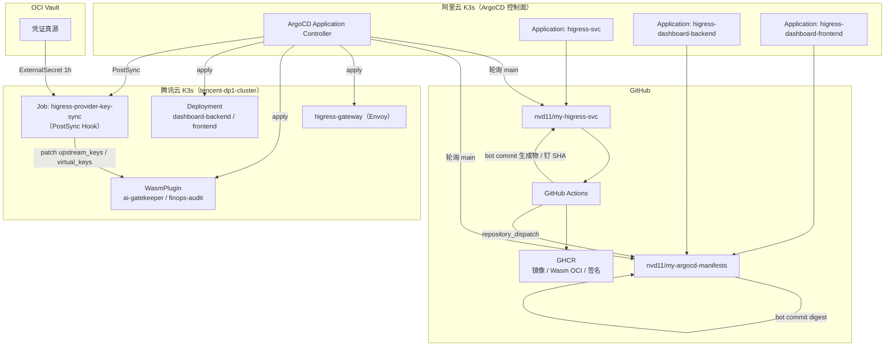
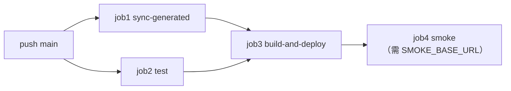
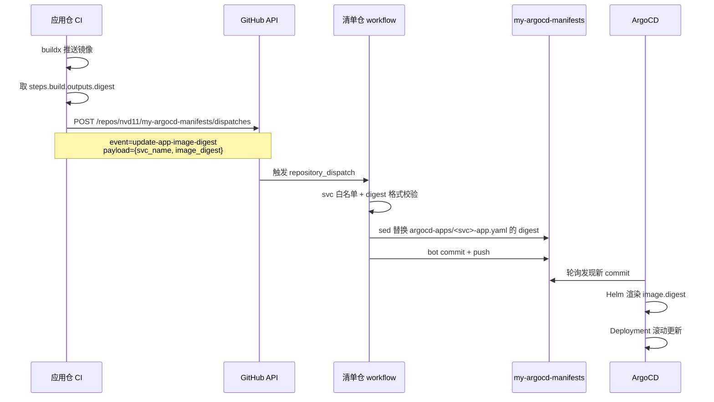

# Higress AI Gateway CI/CD 全链路参考手册

> 更新日期：2026-11-22
> 适用范围：`nvd11/my-higress-svc` + `nvd11/my-argocd-manifests`
> 编写原则：**本文以仓库当前代码为准**，不转述历史文档。旧文档
> `docs/GITOPS_DEPLOYMENT_ARCHITECTURE.md` 存在若干过期描述，差异见
> [第 11 章](#11-已知问题与待办2026-11-22-审计)。

---

## 目录

1. [30 秒速览](#1-30-秒速览)
2. [系统拓扑](#2-系统拓扑)
3. [触发矩阵](#3-触发矩阵)
4. [Wasm 插件流水线](#4-wasm-插件流水线)
5. [Dashboard 后端 / 前端流水线](#5-dashboard-后端--前端流水线)
6. [config.yaml 到部署：生成物链路](#6-configyaml-到部署生成物链路)
7. [凭证与密钥注入](#7-凭证与密钥注入)
8. [ArgoCD 如何感知变更](#8-argocd-如何感知变更)
9. [端到端时间线](#9-端到端时间线)
10. [运维速查与故障排查](#10-运维速查与故障排查)
11. [已知问题与待办（2026-11-22 审计）](#11-已知问题与待办2026-11-22-审计)
12. [新增模型 / Provider 检查清单](#12-新增模型--provider-检查清单)
13. [附录：文件索引](#13-附录文件索引)

---

## 1. 30 秒速览

| 问题 | 答案 |
|---|---|
| 有几条流水线 | 3 条：wasm 插件、dashboard 后端、dashboard 前端 |
| 谁生成 `models_gen.go` / `ingress.yaml` 等 | CI 的 `sync-generated` job（bot 提交），禁止手改 |
| wasm 镜像怎么上线 | CI 推 GHCR 并把 `wasm-plugin.yaml` 钉到 40 位 commit SHA，ArgoCD 轮询后热加载 |
| 后端/前端镜像怎么上线 | CI 用 PAT 向清单仓发 `repository_dispatch`，清单仓 bot 改 `digest`，ArgoCD 轮询后滚动更新 |
| ArgoCD 靠什么触发 | Git 轮询，没有 webhook |
| 凭证从哪来 | OCI Vault → ExternalSecret → K8s Secret → key-sync Job 回填 WasmPlugin |
| 一次 config 改动到生效 | 约 5–10 分钟 |

---

## 2. 系统拓扑



要点：

- ArgoCD 控制面在阿里云，业务负载在腾讯云 `tencent-dp1-cluster`（`higress-system` 命名空间）。
- Wasm 插件走「本仓自动回写」；后端/前端走「跨仓 Digest Dispatch」。
- 对外入站由宿主机 Kong 通过 `http-route-kong.yaml` 暴露 `/v1` 与 `/health`，
  指向 `higress-gateway:8080`。
- 仓库中所有真实密钥都不落 Git，只保留 ExternalSecret 引用与 `{}` 占位。

---

## 3. 触发矩阵

| 流水线 | push 路径（仅 `main`） | PR | `v*` tag | 手动 | 并发策略 |
|---|---|---|---|---|---|
| `wasm-plugin-ci-cd.yml` | `plugins/**`、`config.yaml`、`wasm-plugin.yaml`、`scripts/gen-pricing.sh`、`mcp-bridge.yaml`、`ingress.yaml`、workflow 自身 | 同路径 | 否 | 是 | `cancel-in-progress: false`（串行） |
| `backend-ci-cd.yml` | `services/dashboard-api/**`、workflow 自身 | 否 | 是 | 是 | `cancel-in-progress: true` |
| `frontend-ci-cd.yml` | `frontend/**`、workflow 自身 | 否 | 是 | 是 | `cancel-in-progress: true` |

补充规则：

- `v*` tag 只构建、签名、推镜像，**不派发 GitOps**，避免旧 commit 覆盖线上 digest。
- bot 使用 `GITHUB_TOKEN` 推送的提交**不会再次触发 workflow**（GitHub 机制）；`[skip ci]`
  只是额外保险，换用 PAT 推送时才会真正起作用。
- PR 阶段 wasm 流水线会编译并上传 artifact，但不会推镜像、不会改 `wasm-plugin.yaml`。

---

## 4. Wasm 插件流水线

文件：`.github/workflows/wasm-plugin-ci-cd.yml`



### 4.1 job1 `sync-generated`（仅 main push）

| 步骤 | 说明 |
|---|---|
| checkout | `fetch-depth: 0` |
| 生成 | `bash scripts/gen-pricing.sh` |
| 判定 | 4 个生成物是否有 diff |
| 提交 | bot 身份 commit + push，失败 `pull --rebase` 重试 3 次 |

固定回写清单（workflow 第 58 行）：

```
plugins/finops-audit/pkg/finops/pricing_gen.go
plugins/ai-gatekeeper/models_gen.go
mcp-bridge.yaml
ingress.yaml
```

提交信息：`chore(gitops): regenerate artifacts from config.yaml [skip ci]`

> 该 job **不写任何 `.go` 源文件**，只写上述 4 个生成物。

### 4.2 job2 `test`（push + PR）

| 步骤 | 说明 |
|---|---|
| 重新生成 | 保证测试使用最新产物（不提交） |
| 密钥扫描 | `python3 scripts/secret-scan.py`，扫描 `git ls-files` 全部文本 |
| WasmPlugin 规格校验 | 必须存在 `failStrategy`、`virtual_keys:` 占位；镜像禁止 `:latest`，必须是 40 位 SHA |
| `go vet` | finops-audit、ai-gatekeeper |
| `go test` | 两个插件全量单测 |

密钥扫描当前规则（`scripts/secret-scan.py:38-45`）：

```
sk-[A-Za-z0-9_-]{20,}
AIza[0-9A-Za-z_-]{30,}
-----BEGIN [A-Z ]*PRIVATE KEY-----
```

> 注意：`oc_sk_...` 这类新格式**不会命中**，见第 11 章。

### 4.3 job3 `build-and-deploy`

前置：`needs: [sync-generated, test]`；PR 时 `sync-generated` 为 skipped 也放行。

| 步骤 | 条件 | 说明 |
|---|---|---|
| 重新生成 | 总是 | 确保编译产物与 `config.yaml` 一致 |
| 编译 wasm | 总是 | `GOOS=wasip1 GOARCH=wasm go build -buildmode=c-shared -buildvcs=false` |
| 上传 artifact | 总是 | `higress-wasm-plugins`，含两个 `plugin.wasm` |
| Buildx 推送 | 仅 main | GHCR：`latest` + `${{ github.sha }}` |
| 签名 | 仅 main | `cosign sign`（keyless / OIDC） |
| 钉 SHA | 仅 main | `sed` 改 `wasm-plugin.yaml` 两个 `url:`，bot commit |

镜像仓库：

```
ghcr.io/nvd11/higress-ai-gatekeeper
ghcr.io/nvd11/higress-finops-audit
```

Dockerfile 均为：

```dockerfile
FROM scratch
COPY plugin.wasm /plugin.wasm
```

镜像带 `provenance: true`、`sbom: true`。

### 4.4 job4 `smoke`

条件：`github.ref == refs/heads/main` 且 `vars.SMOKE_BASE_URL != ''`。

`scripts/smoke.sh` 断言：

| 编号 | 断言 |
|---|---|
| G1 | 缺失 Key → 401 |
| G1-b | 伪造 Key → 401 且 body 含 `unauthorized` |
| G2 | 未纳管模型 → 400 `model_not_found` |
| G5 | `/v1/models` 数量等于 `EXPECTED_MODELS`，且不暴露别名 |
| G6 | 真实模型 `deepseek-v4.1-flash-1017` → 200 |

环境变量：

| 名称 | 来源 | 默认 |
|---|---|---|
| `BASE_URL` | `vars.SMOKE_BASE_URL` | 无（未设置则跳过整个 job） |
| `SMOKE_API_KEY` | `secrets.SMOKE_API_KEY` | 无 |
| `EXPECTED_MODELS` | `vars.SMOKE_EXPECTED_MODELS` | `9` |
| `WAIT_ATTEMPTS` / `WAIT_INTERVAL` | 脚本内 | 6 次 / 20s |

### 4.5 Wasm 交付的关键约束

1. `wasm-plugin.yaml` 中的镜像 tag 必须是 40 位 commit SHA，禁止 `latest`。
2. `ai-gatekeeper` 是 `FAIL_CLOSE`：`virtual_keys` 为空会导致全站 401。
3. `finops-audit` 是 `FAIL_OPEN`：审计失败不阻断业务。
4. `imagePullPolicy: Always`，ArgoCD apply 后由 Higress 拉取新 OCI 镜像。
5. Wasm 热加载，不需要重启 `higress-gateway` Pod。

---

## 5. Dashboard 后端 / 前端流水线

### 5.1 后端

文件：`.github/workflows/backend-ci-cd.yml`

| job | runner | 内容 |
|---|---|---|
| `test` | `ubuntu-latest` | `go vet` + `go test -covermode=atomic`，覆盖率门槛 50%；上传 `backend-coverage` artifact（保留 14 天） |
| `build-and-push` | `ubuntu-24.04-arm` | 构建 `linux/arm64` 镜像 → GHCR → cosign 签名 → digest dispatch |

镜像标签：

```
type=sha,format=long      # 完整 commit SHA
type=ref,event=tag        # v* tag
type=raw,value=latest     # 仅 main
```

镜像名：`ghcr.io/nvd11/my-higress-dashboard-backend`

### 5.2 前端

文件：`.github/workflows/frontend-ci-cd.yml`

| job | runner | 内容 |
|---|---|---|
| `build-check` | `ubuntu-latest` | `npm ci` + `tsc --noEmit` + `npm run build` |
| `build-and-push` | `ubuntu-24.04-arm` | 构建 `linux/arm64` 镜像 → GHCR → cosign 签名 → digest dispatch |

镜像名：`ghcr.io/nvd11/my-higress-dashboard-frontend`

### 5.3 Digest Dispatch 时序



清单仓 workflow：`my-argocd-manifests/.github/workflows/update-app-image-digest.yml`

关键校验：

- `svc_name` 必须在白名单内（含 `higress-dashboard-backend` / `higress-dashboard-frontend`）；
- `image_digest` 必须匹配 `^sha256:[a-f0-9]{64}$`；
- 目标文件必须存在，且原本就有 `digest:` 行；
- 只替换行首缩进的 `digest:`，不碰其他字段；
- 提交信息：`ci: update <svc> image digest to <digest> [skip ci]`。

清单文件位置：

```
argocd-apps/higress-dashboard-backend-app.yaml
argocd-apps/higress-dashboard-frontend-app.yaml
```

镜像字段（Helm values 内联）：

```yaml
image:
  repository: ghcr.io/nvd11/my-higress-dashboard-backend
  digest: sha256:<64 位>
  pullPolicy: IfNotPresent
```

### 5.4 为什么用 digest 而不是 tag

| 维度 | tag | digest |
|---|---|---|
| 是否可被覆盖 | 可以 | 不可以 |
| 回滚确定性 | 弱 | 强 |
| 供应链审计 | 一般 | 强（配合 cosign / SBOM） |

因此后端/前端采用「Digest Dispatch」，与 wasm 的「本仓钉 SHA」是两种不同的交付范式。

### 5.5 回滚

| 场景 | 操作 |
|---|---|
| 后端/前端 | 在清单仓 revert 对应 digest commit，ArgoCD 自动同步回旧 digest |
| 或 | 重新发一次 dispatch，把旧 digest 填回去 |
| wasm | revert `chore(gitops): pin wasm images to ...` 提交，或手动把 `wasm-plugin.yaml` 改回上一个 SHA |
| config / 生成物 | revert 源提交，CI 会重新生成并再次回写 |

---

## 6. config.yaml 到部署：生成物链路

### 6.1 唯一真源

`config.yaml` 的 `model_list` 是模型、渠道、价目的唯一真源。每条模型包含：

```yaml
- model_name: "网关对外主名"
  aliases: ["别名"]
  provider: "渠道名"
  protocol: "openai"
  upstream_url: "https://host/path"
  upstream_model: "上游真实模型名"
  api_key: "os.environ/ENV_NAME"
  fallback: "另一个模型"
  pricing:
    prompt_per_1m: 0.0
    completion_per_1m: 0.0
    cache_read_per_1m: 0.0
```

注意：

- `api_key` 必须是 `os.environ/XXX` 引用，禁止明文；
- 同一 `provider` 下的模型必须使用相同的 `scheme + host + port + api_key` 环境变量；
- 生成器**只取 `upstream_url` 的 scheme / host / port，忽略 path**；
- `fallback` 字段目前只是声明，gatekeeper 未实现自动降级。

### 6.2 四个生成物

| 生成物 | 内容 | 消费方 |
|---|---|---|
| `plugins/finops-audit/pkg/finops/pricing_gen.go` | 价目表、provider、provider key 别名、上游模型名 | finops-audit |
| `plugins/ai-gatekeeper/models_gen.go` | 主名清单、别名映射、模型→provider 映射 | ai-gatekeeper |
| `mcp-bridge.yaml` | 每个 provider 一条 DNS registry | Higress McpBridge |
| `ingress.yaml` | 每个 provider 一条精确匹配路由 | Higress Ingress |

生成命令：

```bash
bash scripts/gen-pricing.sh
```

底层执行：

```bash
cd plugins/finops-audit
go run internal/pricinggen/main.go \
  -config ../../config.yaml \
  -out pkg/finops/pricing_gen.go \
  -gatekeeper-out ../ai-gatekeeper/models_gen.go \
  -mcpbridge-out ../../mcp-bridge.yaml \
  -ingress-out ../../ingress.yaml
```

### 6.3 路由生成规则

每个 provider 生成一条 Ingress：

```yaml
metadata:
  labels:
    higress.io/llm-provider: <provider>
  annotations:
    higress.io/backend-protocol: HTTPS
    higress.io/destination: <provider>.dns
    higress.io/upstream-vhost: <host>
    higress.io/exact-match-header-x-higress-llm-provider: <provider>
    higress.io/upstream-key-env: <ENV_NAME>
spec:
  rules:
    - http:
        paths:
          - path: /
            pathType: Prefix
```

设计要点：

- **没有 catch-all 路由**：provider 头缺失或未知 → 404；
- 路由由 `ai-gatekeeper` 在请求体阶段注入 `x-higress-llm-provider` 后触发重选路；
- `higress.io/upstream-key-env` 只登记「需要哪个 Secret 键」，真实 Key 不落 Ingress。

### 6.4 一次 config.yaml 变更的产物流转

```
config.yaml
   │  CI job1 sync-generated
   ├─► pricing_gen.go ──► finops-audit 编译进 wasm
   ├─► models_gen.go ───► ai-gatekeeper 编译进 wasm
   ├─► mcp-bridge.yaml ─► ArgoCD apply
   └─► ingress.yaml ────► ArgoCD apply

CI job3 build-and-deploy
   └─► wasm-plugin.yaml 钉新 SHA ─► ArgoCD apply ─► Envoy 热加载
```

---

## 7. 凭证与密钥注入

### 7.1 三层结构

```
OCI Vault（唯一真源）
   │  ExternalSecret，每 1h 刷新
   ▼
K8s Secret: higress-ai-secrets
   │  key-sync Job（ArgoCD PostSync Hook）
   ▼
WasmPlugin.defaultConfig
   ├─ upstream_keys  {provider: 上游真实 Key}
   └─ virtual_keys   {网关 Virtual Key: 消费者别名}
```

### 7.2 ExternalSecret

文件：`secrets.yaml`

- SecretStore：`oci-litellm-vault-store`
- 目标 Secret：`higress-ai-secrets`
- 刷新周期：`1h`
- 所有 `remoteRef.key` 必须在 OCI Vault 中真实存在，否则 ExternalSecret 会
  `Degraded`，进而拖垮 ArgoCD 应用健康状态。

### 7.3 key-sync Job

文件：`key-sync-job.yaml`

| 属性 | 值 |
|---|---|
| 类型 | `batch/v1 Job` |
| ArgoCD 钩子 | `PostSync` |
| 删除策略 | `BeforeHookCreation` |
| sync-wave | `10` |
| 失败重试 | `backoffLimit: 2` |
| 完成后保留 | `ttlSecondsAfterFinished: 3600` |
| ServiceAccount | `higress-provider-key-sync` |

执行逻辑：

1. 列出 `higress-system` 下带 `app.kubernetes.io/part-of=my-higress-svc` 的 Ingress；
2. 读取每条 Ingress 的 `higress.io/upstream-key-env` 与 `higress.io/llm-provider`；
3. 从 Secret 取对应值，拼成 `upstream_keys` map，merge-patch 进 `ai-gatekeeper`；
4. 读取 `HIGRESS_VIRTUAL_KEYS_JSON`，用 JSON Patch 整体替换两个插件的 `virtual_keys`；
5. 回读校验：`virtual_keys` / `upstream_keys` 为空则 `exit 1`，让 ArgoCD 同步失败。

### 7.4 为什么 ArgoCD 必须 ignoreDifferences

`key-sync` 是运行时 patch，集群里的值不在 Git 中。若不忽略，`selfHeal` 会把这些字段清空：

| 资源 | 忽略字段 | 不忽略的后果 |
|---|---|---|
| `Secret/higress-ai-secrets` | `/data` | 真实密钥被 Git 中的空值覆盖 |
| `Service/higress-gateway` | `/spec/publishNotReadyAddresses` | 本地高可用配置被清 |
| `HTTPRoute` | `/status` | 状态字段反复漂移 |
| `WasmPlugin/ai-gatekeeper` | `/spec/defaultConfig/upstream_keys` | 上游 Key 被清空 → 全部 401 |
| `WasmPlugin/ai-gatekeeper` | `/spec/defaultConfig/virtual_keys` | 网关 Virtual Key 被清空 → 全站 401 |
| `WasmPlugin/finops-audit` | `/spec/defaultConfig/virtual_keys` | 审计插件鉴权失效 |

同时 App 必须设置 `RespectIgnoreDifferences=true`，否则同步阶段仍会按 Git 值覆盖。

### 7.5 GitHub 侧 Secrets / Variables

| 名称 | 类型 | 用途 |
|---|---|---|
| `GITHUB_TOKEN` | 自动 | checkout、推 GHCR、bot commit |
| `ARGOCD_MANIFESTS_DISPATCH_TOKEN` | Secret（PAT） | 向后端/前端清单仓发 `repository_dispatch` |
| `SMOKE_API_KEY` | Secret | 冒烟测试用 Virtual Key |
| `SMOKE_BASE_URL` | Variable | 冒烟目标地址；为空则跳过 smoke job |
| `SMOKE_EXPECTED_MODELS` | Variable | `/v1/models` 期望数量；未设置时默认 9 |

---

## 8. ArgoCD 如何感知变更

### 8.1 Application 结构

`higress-svc`（`my-argocd-manifests/argocd-apps/higress-svc-app.yaml`）：

```yaml
spec:
  sources:
    - chart: higress-core
      repoURL: https://higress.io/helm-charts
      targetRevision: 2.2.5
      helm:
        valueFiles:
          - $values/values.yaml

    - repoURL: https://github.com/nvd11/my-higress-svc.git
      targetRevision: main
      ref: values
      path: .
  destination:
    name: tencent-dp1-cluster
    namespace: higress-system
```

说明：

- 源 2 既是 `$values` 的值文件来源，也因设置了 `path: .` 而参与资源渲染
  （ArgoCD 官方行为：ref 源设置 path 时会从该路径生成资源）；
- 根目录当前参与渲染的 K8s 清单：`ingress.yaml`、`mcp-bridge.yaml`、
  `wasm-plugin.yaml`、`secrets.yaml`、`key-sync-job.yaml`、`http-route-kong.yaml`；
- `config.yaml` / `values.yaml` 不是 K8s 资源，不会被 apply。

两个 dashboard Application 使用共享 Helm Chart：

```
repoURL: https://github.com/nvd11/my-shared-helm-charts.git
path: charts/generic-web-service-v2
```

### 8.2 轮询，不是 webhook

本仓库与清单仓都**没有配置 ArgoCD webhook**。ArgoCD 按全局轮询周期检测 Git
（常见默认 3 分钟，具体以集群 `argocd-cm` 为准）。

因此：

- CI 结束后到真正上线，存在 0–3 分钟的等待窗口；
- 想要立即生效，可手动刷新：

```bash
kubectl -n argocd annotate app higress-svc \
  argocd.argoproj.io/refresh=normal --overwrite
```

### 8.3 syncPolicy

```yaml
syncPolicy:
  automated:
    prune: true
    selfHeal: true
  syncOptions:
    - CreateNamespace=true
    - RespectIgnoreDifferences=true
```

### 8.4 PostSync Hook

每次 ArgoCD 同步完成后，`key-sync-job` 以 PostSync Hook 运行，负责把 OCI Vault
里的真实 Key 回填到 WasmPlugin。它不参与镜像版本管理。

---

## 9. 端到端时间线

### 9.1 修改 `config.yaml`

| 步 | 事件 | 估计耗时 |
|---|---|---|
| 1 | push / merge 到 main | — |
| 2 | `sync-generated` 与 `test` 并行启动 | 0:00 |
| 3 | test 通过；sync bot 提交 4 个生成物 | 1–2 min |
| 4 | `build-and-deploy` 编译、推镜像、签名、钉 SHA | 2–4 min |
| 5 | ArgoCD 下一次轮询看到新 commit | 0–3 min |
| 6 | apply Ingress / McpBridge / WasmPlugin，Envoy 热加载 | 秒级–1 min |
| 7 | PostSync Hook 回填上游 Key | 10–30 s |
| 8 | smoke 契约测试 | 约 1 min |
| 合计 | | **约 5–10 分钟** |

### 9.2 修改 wasm 源码

与 9.1 相同，只是生成物通常无 diff；镜像 SHA 变化。

### 9.3 修改后端 / 前端

| 步 | 事件 | 估计耗时 |
|---|---|---|
| 1 | push 到 main | — |
| 2 | test / build-check | 1–3 min |
| 3 | 构建 arm64 镜像、签名、推送 | 2–4 min |
| 4 | dispatch 到清单仓，bot 改 digest 并提交 | 20–40 s |
| 5 | ArgoCD 轮询清单仓 | 0–3 min |
| 6 | Deployment 滚动更新 | 30 s–1 min |
| 合计 | | **约 4–8 分钟** |

---

## 10. 运维速查与故障排查

### 10.1 查状态

```bash
# ArgoCD 应用状态
kubectl -n argocd get app higress-svc
kubectl -n argocd get app higress-dashboard-backend
kubectl -n argocd get app higress-dashboard-frontend

# 当前生效的 wasm 镜像
kubectl -n higress-system get wasmplugin ai-gatekeeper -o jsonpath='{.spec.url}'
kubectl -n higress-system get wasmplugin finops-audit -o jsonpath='{.spec.url}'

# key-sync 最近一次结果
kubectl -n higress-system get job -l app.kubernetes.io/name=higress-provider-key-sync
kubectl -n higress-system logs job/higress-provider-key-sync
```

### 10.2 常见故障

| 现象 | 可能原因 | 排查 |
|---|---|---|
| 所有请求 401 | `virtual_keys` 为空（FAIL_CLOSE） | 看 key-sync 日志、Secret `HIGRESS_VIRTUAL_KEYS_JSON` |
| 某模型 404 | provider 头未注入 / Ingress 未生成 | 查 `x-higress-llm-provider`、`ingress.yaml` 是否含该 provider |
| 上游 401 | `upstream_keys` 未回填 | 查 Ingress 的 `upstream-key-env` 与 Secret 键名 |
| 400 `model_not_found` | wasm 白名单未更新 | 查 `models_gen.go`、镜像 SHA 是否最新 |
| smoke 数量断言失败 | `SMOKE_EXPECTED_MODELS` 未同步 | 更新仓库 Variable |
| ArgoCD `Degraded` | ExternalSecret 的 remote key 不存在 | 查 OCI Vault / ExternalSecret 事件 |
| 镜像拉取失败 | GHCR 私有或节点无凭据 | 查 Pod 事件、GHCR 可见性 |
| bot push 被拒 | 分支保护 / 并发 | 看 workflow 日志中的 rebase 重试 |
| wasm 未生效 | Argo 未轮询 / 镜像 tag 未变 | 手动 refresh，确认 `wasm-plugin.yaml` SHA |

### 10.3 手工验证网关

```bash
# 模型清单
curl -s https://<gateway>/v1/models -H "Authorization: Bearer <virtual-key>"

# 真实推理
curl -s https://<gateway>/v1/chat/completions \
  -H "Authorization: Bearer <virtual-key>" \
  -H "Content-Type: application/json" \
  -d '{"model":"deepseek-v4.1-flash-1017","messages":[{"role":"user","content":"ping"}],"max_tokens":8}'
```

---

## 11. 已知问题与待办（2026-11-22 审计）

| # | 级别 | 问题 | 证据 | 建议 |
|---|---|---|---|---|
| 1 | 高 | 旧文档曾含明文 SSH / sudo 口令（仓库为 PUBLIC） | 2026-11-22 已从工作树移除；Git 历史仍保留（自 `782eaca` / `6aa977c` 起） | 立即轮换两套口令；历史是否用 `git filter-repo` 清理另行评估 |
| 2 | 高 | 密钥扫描不识别 `oc_sk_` 新格式 | `scripts/secret-scan.py:38-45` 实测 `oc_sk_...` 返回 False | 增加 `oc_sk_[A-Za-z0-9_-]{20,}` 规则 |
| 3 | 中 | 文档声称的漂移护栏已不存在 | `git log -S "git diff --exit-code"` 显示 `9b22bb1` 删除；当前 workflow 无该步骤 | 要么恢复护栏，要么修正文档 |
| 4 | 中 | smoke 模型数量与实际不一致 | 脚本默认 9；`config.yaml` 当前 10；旧文档写 11 | 统一由 `SMOKE_EXPECTED_MODELS` 管理并写入文档 |
| 5 | 中 | smoke 可能测到旧版本 | smoke 只等「可达」，不等 Argo 同步完成 | 增加版本断言或轮询 `/v1/models` 期望值 |
| 6 | 中 | 「配置 + 产物」并非原子提交 | trigger commit → 生成物 commit → 钉 SHA commit 三次提交 | 文档不要宣称原子性；或改为 PR 内生成 |
| 7 | 中 | key-sync 用 merge patch，删除 provider 后旧 Key 残留 | `key-sync-job.yaml` 第 135 行 | 改为整体替换或先清空再写入 |
| 8 | 低 | 后端/前端并发构建无顺序保证 | 清单仓仅串行化写入，不校验新旧 | 在 payload 带 build 时间/commit，旧构建丢弃 |
| 9 | 低 | 清单仓残留废弃项 | 白名单仍含 `higress-gemini-adapter`；`update-image-tag.yml` 仍用 `checkout@v3` | 清理白名单与旧 workflow |
| 10 | 低 | 旧文档技术参数过期 | Go 1.24 vs 实际 1.26；触发路径未更新 | 以本文为准，逐步修订旧文档 |
| 11 | 设计限制 | 生成器忽略 `upstream_url` 的 path | `pricinggen` 仅解析 scheme/host/port | 接入带路径前缀的上游时需在 gatekeeper 或注解层补 rewrite |
| 12 | 设计限制 | `fallback` 字段未实现 | gatekeeper 无降级逻辑 | 如需 429 自动回退，需单独开发 |

---

## 12. 新增模型 / Provider 检查清单

以新增一个 provider 为例，按顺序执行：

### 12.1 代码与配置

- [ ] 在 `config.yaml` 的 `model_list` 增加模型：
  - `model_name` 全局唯一；
  - `provider` 显式声明；
  - `upstream_url` 填完整地址（生成器只用 host/port）；
  - `upstream_model` 填上游真实模型名；
  - `api_key` 写 `os.environ/XXX`；
  - `pricing` 三项必填（订阅制可写 0）。
- [ ] 同一 provider 下所有模型的 `scheme + host + port + api_key` 保持一致。
- [ ] 如需改写请求体中的模型名、或上游有路径前缀 / 自定义请求头，确认
      `ai-gatekeeper` 是否具备对应能力（当前不具备，需要改代码）。

### 12.2 凭证

- [ ] 在 OCI Vault 写入 `remoteRef.key`；
- [ ] 在 `secrets.yaml` 增加对应 `secretKey`；
- [ ] 确认 `higress-provider-key-sync` 能从 Secret 读到值。
- [ ] 若 key 是新格式，扩展 `scripts/secret-scan.py` 的规则。

### 12.3 CI / 冒烟

- [ ] 更新仓库 Variable `SMOKE_EXPECTED_MODELS`（当前 10，新增 2 个则为 12）；
- [ ] 确认 `smoke.sh` 使用的真实模型仍然存在。

### 12.4 发布与验证

- [ ] 合并后观察 `sync-generated` / `test` / `build-and-deploy` 全绿；
- [ ] 确认 bot 已回写 4 个生成物且 `wasm-plugin.yaml` 已钉新 SHA；
- [ ] ArgoCD `Synced / Healthy`；
- [ ] key-sync Job 成功且回读校验通过；
- [ ] `GET /v1/models` 数量正确；
- [ ] 目标模型真实请求 200；
- [ ] 审计记录中 provider / providerKeyAlias 正确。

### 12.5 部署顺序注意

1. **先写 OCI Vault，再合并 `secrets.yaml`**：ExternalSecret 缺 key 会 Degraded；
2. **先生成物提交，再钉镜像 SHA**：这是 CI 自动完成的，不要手工干预；
3. **不要手改生成物**：下一次 CI 会覆盖，且当前已无漂移护栏。

---

## 13. 附录：文件索引

### 13.1 流水线

| 文件 | 职责 |
|---|---|
| `.github/workflows/wasm-plugin-ci-cd.yml` | 生成物回写、单测、编译、推送、签名、钉 SHA、冒烟 |
| `.github/workflows/backend-ci-cd.yml` | 后端测试、镜像、签名、digest dispatch |
| `.github/workflows/frontend-ci-cd.yml` | 前端类型检查、构建、镜像、签名、digest dispatch |
| `.github/dependabot.yml` | Go / npm / Actions 每周依赖更新 |

### 13.2 脚本

| 文件 | 职责 |
|---|---|
| `scripts/gen-pricing.sh` | 调用 pricinggen，产出 4 个生成物 |
| `scripts/secret-scan.py` | 全仓明文密钥扫描 |
| `scripts/smoke.sh` | 部署后契约测试 |

### 13.3 声明式清单

| 文件 | 职责 |
|---|---|
| `config.yaml` | 模型 / 渠道 / 价目唯一真源 |
| `values.yaml` | higress-core Helm values |
| `ingress.yaml` | 生成物：每 provider 一条路由 |
| `mcp-bridge.yaml` | 生成物：每 provider 一条 DNS registry |
| `wasm-plugin.yaml` | 两个 WasmPlugin 定义，镜像 tag 由 CI 钉 SHA |
| `secrets.yaml` | ExternalSecret，引用 OCI Vault |
| `key-sync-job.yaml` | PostSync Hook，回填真实 Key |
| `http-route-kong.yaml` | Kong 入站路由 |

### 13.4 ArgoCD 清单仓

| 文件 | 职责 |
|---|---|
| `argocd-apps/higress-svc-app.yaml` | 网关主应用（higress-core + 本仓根目录） |
| `argocd-apps/higress-dashboard-backend-app.yaml` | 后端 Helm 应用，image.digest |
| `argocd-apps/higress-dashboard-frontend-app.yaml` | 前端 Helm 应用，image.digest |
| `.github/workflows/update-app-image-digest.yml` | 接收 dispatch，改 digest 并提交 |
| `.github/workflows/update-image-tag.yml` | 历史 tag 更新通道（当前 higress 两个服务未使用） |

### 13.5 插件

| 文件 | 职责 |
|---|---|
| `plugins/ai-gatekeeper/main.go` | 鉴权、模型白名单、别名改写、provider 头注入、路由重选 |
| `plugins/ai-gatekeeper/models_gen.go` | 生成物：主名 / 别名 / provider 映射 |
| `plugins/finops-audit/main.go` | Token 统计、状态码捕获、异步审计 |
| `plugins/finops-audit/pkg/finops/pricing_gen.go` | 生成物：价目表 |
| `plugins/finops-audit/internal/pricinggen/main.go` | 生成器源码 |

---

## 变更记录

| 日期 | 变更 |
|---|---|
| 2026-11-22 | 首版：按当前代码重写 CI/CD 全链路，修正旧文档 4 处过期描述，补充 12 项审计发现 |
