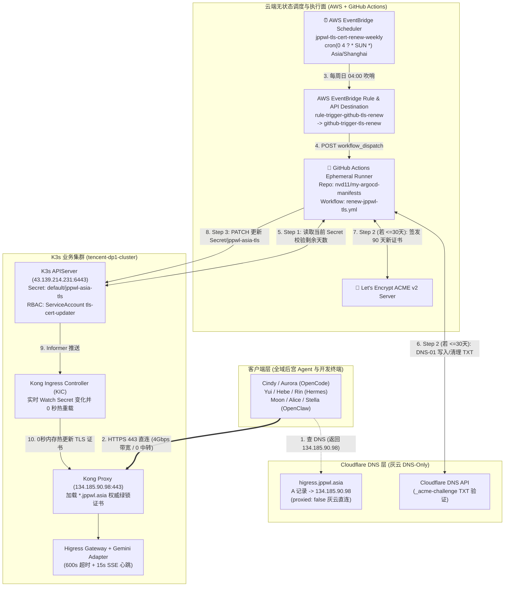
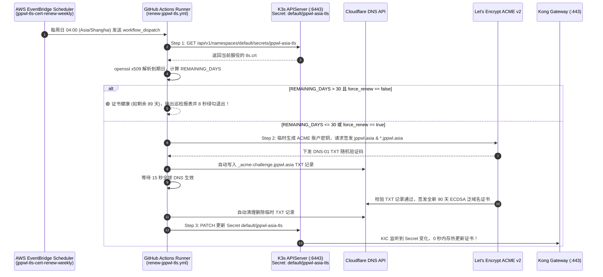

# 大模型网关终极网络破局：Cloudflare 灰云直连 + AWS EventBridge + GitHub Actions 无状态 Let's Encrypt 泛域名证书全自动续期架构指南

> 📚 **文档定位**：完整记录 `higress.jppwl.asia` 及 `*.jppwl.asia` 全域网关如何摆脱 Cloudflare 小黄云 100 秒超时（HTTP 524）、OCI 免费 ALB 10Mbps 带宽限制以及传统单机 Crontab/Systemd 宠物状态（Pet State），通过 **AWS EventBridge Scheduler + GitHub Actions 无状态流水线 + K8s 最小权限 RBAC + Kong Gateway API 443 原生监听** 实现 4Gbps 满血直连与证书零人工全自动续期闭环。
>
> **更新时间**：2026-10-17 · **维护者**：Cindy

---

## 目录
1. [架构演进：为什么选择「灰云直连 + AWS EventBridge + GitHub Actions」？](#1-架构演进为什么选择灰云直连--aws-eventbridge--github-actions)
2. [全链路网络与无状态自动续期架构拓扑图](#2-全链路网络与无状态自动续期架构拓扑图)
3. [核心三问速查：Scheduler 在哪跑？多久跑一次？脚本在哪？](#3-核心三问速查scheduler-在哪跑多久跑一次脚本在哪)
4. [全套核心代码与云端资源清单（逐文解析）](#4-全套核心代码与云端资源清单逐文解析)
5. [无状态智能前置探针与 ACME 自动续期时序图](#5-无状态智能前置探针与-acme-自动续期时序图)
6. [日常运维、手动强制续签与状态检查速查命令](#6-日常运维手动强制续签与状态检查速查命令)

---

## 1. 架构演进：为什么选择「灰云直连 + AWS EventBridge + GitHub Actions」？

在大模型网关（Higress / LiteLLM）承载次世代深度思考模型（如 **Gemini 4 Argon**）以及生成数千行代码的工具调用（如 `write_file` 绘制大型内嵌 SVG 动画）时，单次推理耗时极易突破 100~180 秒。我们对四代方案进行了深度对比：

| 评估维度 | 阶段一：Cloudflare 小黄云 (`proxied: true`) | 阶段二：灰云 + OCI 免费 ALB (`161.118.240.179`) | 阶段三：灰云 + 宿主机本地 `certbot.timer` | 🏆 阶段四：灰云 + Kong 443 + AWS EventBridge + GitHub Actions (当前终极形态) |
| :--- | :--- | :--- | :--- | :--- |
| **接入 URL** | `https://higress.jppwl.asia/v1` | `http://gw.jpgcp.cloud/litellm/v1` | `https://higress.jppwl.asia/v1` | **`https://higress.jppwl.asia/v1`** |
| **超时上限** | 🔴 **100~120 秒强制断流 (`HTTP 524`)** | 🟢 1800 秒 | 🟢 600~1800 秒 | 🏆 **600~1800 秒自主可控（+15s SSE 心跳保活，零 524 断流）** |
| **公网带宽上限** | 受限于 CF 回源抖动 | 🟡 **硬锁 10 Mbps** (OCI 免费 ALB 上限) | 🟢 4,000 Mbps (4 Gbps) | 🏆 **4,000 Mbps (4 Gbps 宿主机原生万兆网卡直达！)** |
| **服务器无状态性** | 无状态 | 依赖外部 ALB 实例 | 🔴 **有状态宠物机**（重装系统即丢失 `/etc/letsencrypt` 与定时任务） | 🏆 **100% 纯净无状态（宿主机 0 脚本、0 密钥文件残留，逻辑全在 Git）** |
| **密钥安全性** | 托管于 CF | 无 | 🟡 宿主机磁盘留存明文 `.ini` 与 Token | 🏆 **收归 GitHub Encrypted Secrets，临时 Runner 算完即焚** |
| **可观测性与控制面** | 黑盒 | 需查 OCI 控制台 | 🔴 需 SSH 登录查 `journalctl` | 🏆 **与 `sms-flink-etl` 统一由 AWS EventBridge 调度，GitHub Actions 可视化大屏 + 一键强签** |

---

## 2. 全链路网络与无状态自动续期架构拓扑图



---

## 3. 核心三问速查：Scheduler 在哪跑？多久跑一次？脚本在哪？

### Q1：Scheduler（定时调度器）在哪里跑？
* **所在平台**：**Amazon Web Services (AWS 新加坡机房 `ap-southeast-1`，账号 ID：`186004631963`)** —— 与主人的 Flink 财务湖仓批处理使用完全相同的云端调度底座！
* **调度链路（三级联动）**：
  1. **AWS EventBridge Scheduler**：`jppwl-tls-cert-renew-weekly`（ARN：`arn:aws:scheduler:ap-southeast-1:186004631963:schedule/default/jppwl-tls-cert-renew-weekly`）；
  2. **AWS EventBridge Rule**：`rule-trigger-github-tls-renew`（匹配事件 `source: ["infra.tls-cert"]`, `detail-type: ["renew-jppwl-tls"]`）；
  3. **AWS EventBridge API Destination**：`github-trigger-tls-renew`（复用已授权的 `github-api-conn`，向 GitHub API 发起 `POST /repos/nvd11/my-argocd-manifests/actions/workflows/renew-jppwl-tls.yml/dispatches`）。

### Q2：什么时候跑一次？如何避免无状态 Runner 重复签发触发限流？
* **巡检周期**：**每周日凌晨 `04:00`（北京时间 `Asia/Shanghai`）自动跑一次**（表达式：`cron(0 4 ? * SUN *)`）。
* **无状态智能前置探针（Smart Pre-check）**：
  - 每次 GitHub Actions 被唤醒后，**Step 1** 会直接通过 K3s API 读取线上正在服役的 `Secret/jppwl-asia-tls` 中的公钥证书，用 `openssl x509 -enddate` 计算剩余有效天数（`REMAINING_DAYS`）：
  - **当 `REMAINING_DAYS > 30`（且 `force_renew == false`）时**：Step 1 直接判定 `🟢 HEALTHY - SKIP RENEWAL`，输出漂亮的 Markdown 巡检报表后 **8 秒钟绿勾结束**，完全不调用 Let's Encrypt 和 Cloudflare，0 速率限制风险！
  - **当 `REMAINING_DAYS <= 30`（或手动传入 `force_renew == true`）时**：自动进入 Step 2 & Step 3，在临时 Runner 内安装 `certbot`、完成 Cloudflare DNS-01 泛域名签发，并将新证书 `PATCH` 进 K3s `Secret/jppwl-asia-tls`！

### Q3：续期脚本与配置文件在哪里？
* **宿主机 `free-arm-vm` (`134.185.90.98`)**：**0 残留！** 本地 `certbot` 与 `/etc/letsencrypt` 已彻底卸载清理，宿主机保持 100% 纯净无状态。
* **续期 Workflow 脚本路径**：
  - GitHub 仓库：**`nvd11/my-argocd-manifests`**
  - 文件路径：**`.github/workflows/renew-jppwl-tls.yml`**（本地工作区路径：`/home/gateman/projects/github/my-argocd-manifests/.github/workflows/renew-jppwl-tls.yml`）
* **加密凭据位置（GitHub Encrypted Secrets in `nvd11/my-argocd-manifests`）**：
  - `CF_DNS_API_TOKEN`：Cloudflare `jppwl.asia` 域名的 DNS 编辑 Token；
  - `K3S_API_SERVER_URL`：`https://43.139.214.231:6443`；
  - `K3S_TLS_SA_TOKEN`：K3s `default` 命名空间下最小权限服务账号 `tls-cert-updater` 的 Token。
* **K3s 网关与 RBAC 定义路径**：
  - 文件路径：`infrastructure/kong-gateway/Gateway.yaml`（位于 `nvd11/my-argocd-manifests` 仓库）。

---

## 4. 全套核心代码与云端资源清单（逐文解析）

### 4.1 GitHub Actions 续期流水线 (`.github/workflows/renew-jppwl-tls.yml`)

```yaml
name: Renew Let's Encrypt Wildcard TLS Certificate

on:
  workflow_dispatch:
    inputs:
      force_renew:
        description: 'Force issue a new certificate even if >30 days remaining'
        required: false
        default: 'false'
        type: choice
        options:
          - 'false'
          - 'true'
      threshold_days:
        description: 'Renewal threshold in remaining days (default: 30)'
        required: false
        default: '30'
        type: string
  repository_dispatch:
    types: [renew-jppwl-tls]

permissions:
  contents: read

jobs:
  check-and-renew-tls:
    name: Stateless TLS Inspection & Automated Renewal
    runs-on: ubuntu-latest
    timeout-minutes: 10

    steps:
      - name: 1. Inspect Live Certificate Expiry on K3s / Kong Gateway
        id: check_cert
        env:
          K3S_API_URL: ${{ secrets.K3S_API_SERVER_URL }}
          K3S_TOKEN: ${{ secrets.K3S_TLS_SA_TOKEN }}
          FORCE_RENEW: ${{ inputs.force_renew || github.event.client_payload.force_renew || 'false' }}
          THRESHOLD_DAYS: ${{ inputs.threshold_days || github.event.client_payload.threshold_days || '30' }}
        run: |
          set -euo pipefail

          echo "🔍 Fetching active certificate from K3s Secret (default/jppwl-asia-tls)..."
          CRT_B64=$(curl -k -s --connect-timeout 10 \
            -H "Authorization: Bearer ${K3S_TOKEN}" \
            "${K3S_API_URL}/api/v1/namespaces/default/secrets/jppwl-asia-tls" | jq -r '.data["tls.crt"] // empty')

          if [ -z "$CRT_B64" ]; then
            echo "⚠️ No valid tls.crt found in K3s Secret! Proceeding with fresh issuance..."
            echo "should_renew=true" >> "$GITHUB_OUTPUT"
            exit 0
          fi

          END_DATE_STR=$(echo "$CRT_B64" | base64 -d | openssl x509 -noout -enddate | cut -d= -f2)
          ISSUER_STR=$(echo "$CRT_B64" | base64 -d | openssl x509 -noout -issuer | sed 's/^issuer=//')
          END_EPOCH=$(date -d "$END_DATE_STR" +%s)
          NOW_EPOCH=$(date +%s)
          REMAINING_DAYS=$(( (END_EPOCH - NOW_EPOCH) / 86400 ))

          if [ "$FORCE_RENEW" = "true" ] || [ "$REMAINING_DAYS" -le "$THRESHOLD_DAYS" ]; then
            DECISION="🔄 RENEW REQUIRED (force_renew=${FORCE_RENEW}, remaining=${REMAINING_DAYS}d <= ${THRESHOLD_DAYS}d)"
            SHOULD_RENEW="true"
          else
            DECISION="🟢 HEALTHY - SKIP RENEWAL (remaining=${REMAINING_DAYS}d > ${THRESHOLD_DAYS}d)"
            SHOULD_RENEW="false"
          fi

          echo "should_renew=${SHOULD_RENEW}" >> "$GITHUB_OUTPUT"

      - name: 2. Issue New Let's Encrypt Wildcard Certificate via Cloudflare DNS-01
        if: steps.check_cert.outputs.should_renew == 'true'
        env:
          CF_TOKEN: ${{ secrets.CF_DNS_API_TOKEN }}
        run: |
          set -euo pipefail
          sudo apt-get update -qq
          sudo apt-get install -y -qq certbot python3-certbot-dns-cloudflare

          echo "dns_cloudflare_api_token = ${CF_TOKEN}" > /tmp/cf_dns.ini
          chmod 600 /tmp/cf_dns.ini

          sudo certbot certonly --dns-cloudflare \
            --dns-cloudflare-credentials /tmp/cf_dns.ini \
            --dns-cloudflare-propagation-seconds 15 \
            -d "jppwl.asia" -d "*.jppwl.asia" \
            --key-type ecdsa \
            --non-interactive --agree-tos -m gateman56@gmail.com

          rm -f /tmp/cf_dns.ini

      - name: 3. Sync New Certificate to K3s Secret (default/jppwl-asia-tls)
        if: steps.check_cert.outputs.should_renew == 'true'
        env:
          K3S_API_URL: ${{ secrets.K3S_API_SERVER_URL }}
          K3S_TOKEN: ${{ secrets.K3S_TLS_SA_TOKEN }}
        run: |
          set -euo pipefail
          CERT_DIR="/etc/letsencrypt/live/jppwl.asia"
          CRT_B64=$(sudo base64 -w0 "$CERT_DIR/fullchain.pem")
          KEY_B64=$(sudo base64 -w0 "$CERT_DIR/privkey.pem")

          HTTP_CODE=$(curl -k -s -o /tmp/k3s_resp.json -w "%{http_code}" --connect-timeout 15 -X PATCH \
            "${K3S_API_URL}/api/v1/namespaces/default/secrets/jppwl-asia-tls" \
            -H "Authorization: Bearer ${K3S_TOKEN}" \
            -H "Content-Type: application/strategic-merge-patch+json" \
            -d "{\"data\":{\"tls.crt\":\"${CRT_B64}\",\"tls.key\":\"${KEY_B64}\"}}")

          if [ "$HTTP_CODE" != "200" ]; then
            cat /tmp/k3s_resp.json
            exit 1
          fi
```

---

## 5. 无状态智能前置探针与 ACME 自动续期时序图



---

## 6. 日常运维、手动强制续签与状态检查速查命令

### 6.1 手动触发一次巡检（不强制重签，8 秒出报表）
```bash
gh workflow run renew-jppwl-tls.yml -R nvd11/my-argocd-manifests
```

### 6.2 手动强制立即重签一张新证书并同步进 K3s (`force_renew=true`)
```bash
gh workflow run renew-jppwl-tls.yml -R nvd11/my-argocd-manifests -f force_renew=true
```

### 6.3 查看最近几次巡检/续期流水线状态
```bash
gh run list -R nvd11/my-argocd-manifests -w "Renew Let's Encrypt Wildcard TLS Certificate" -L 5
```

### 6.4 在 Radxa 上查看 AWS EventBridge Scheduler 状态
```bash
ssh gateman@100.115.214.26 'export PATH="$HOME/.local/bin:/usr/local/bin:$PATH"; aws scheduler get-schedule --name jppwl-tls-cert-renew-weekly --region ap-southeast-1'
```
