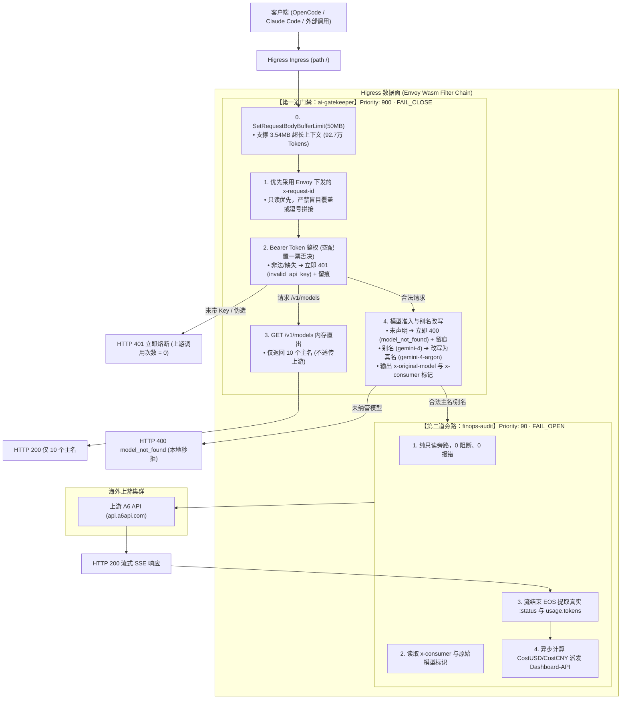
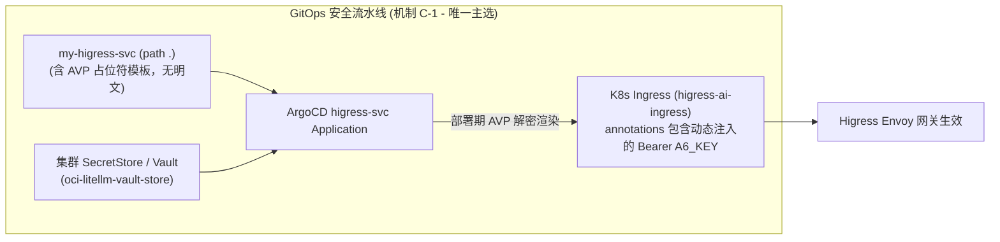
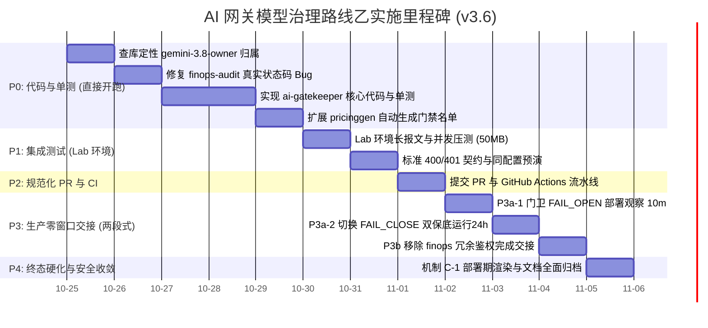

# AI 网关模型治理改造方案 (v3.6 · 生产就绪去冗直推版)

> **目标**：让 `config.yaml` 成为**模型清单（model list）与计费价目**的唯一标准（Single Source of Truth），
> 终结“网关纯透传、上游 143 个模型全放行、别名全部 400”的现状。
>
> **核心路线裁决**：👑 **主人正式拍板选定【路线乙：自研极简门卫 `ai-gatekeeper`】！**
> 彻底摒弃借上游 A6 拒收未知模型的丑陋 Hack（`* -> ___not_declared___`），由独立的门卫插件在网关边缘提供标准 OpenAI 风格的 `model_not_found` 与 `invalid_api_key`，同时原生拦截 `/v1/models` 并注入原始模型跟踪标记，实现最极致、最高雅的代码洁癖与三权分立！
>
> **编制与评审**：Dora (方案起草编写💋) · Cindy (深度技术评审与严格对账❤️)  
> **基线分支**：`backup/pre-modelmapping-20261024`（Commit `1cfa372`）  
> **版本修订记录**：
> - v1.0 (`8c81855`, Cindy 主笔)：建立实测证据链（E1~E8）、选定声明式路线基准、梳理 22 条映射与 R1~R7 风险册；
> - v2.0 (Dora 建议)：抓出 `finops-audit` 状态码写死 200 Bug（D1），确立鉴权与审计分立原则；
> - v3.0 (联合共识)：纠正虚构插件与参数，锁定自研门卫路线乙；
> - v3.1 (Cindy 评审对账)：锁定 50MB 缓冲、确立改头决策树、新增 G7、时效修正为 3~5 分钟；
> - v3.2 (补丁全量落地)：落实 Cindy 6 条补丁（P4 凭证机制、空 virtual_keys、CI 一致性、工期校准、G1 定量化、x-request-id 规范）；
> - v3.3 (闭环 M-1/M-2/M-3)：落实 M-1（只读优先+B3）、M-2（机制 C 唯一定稿）、M-3（工期统一）；
> - v3.4 (闭环 N-0/N-1/N-2/N-3)：纠正 `FAIL_CLOSE` 合法枚举、落实 P3a 两段式上线、厘清 AVP 渲染落点 `higress-svc`、补充方案 B 降级说明与 CI dry-run 服务端校验；
> - v3.5 (全面对账定稿)：恢复 G8 漂移护栏、剔除过度承诺、100% 对齐 22 个合法键并补全 YAML/代码规格；
> - **v3.6（本案 · 主人裁决去冗直推版）**：
>   1. **彻底废除独立 P0.0 散装 POC 阶段（净省 7h 冗余工期）**：
>      现存生产插件 `plugins/finops-audit/main.go:68` 早就常态化配置了 `ctx.SetRequestBodyBufferLimit(50MB)`，近 7 天生产中已有 **1,097 次 > 1MB 的超长大报文（含单次 3.54MB / 92.7万 Tokens）** 稳定穿透、被完整读取并成功归档至 VictoriaLogs 与 Redis！
>      底层 50MB 缓冲机制与全量 Payload 读取能力**已是 100% 验证过的线上成熟事实资产**，绝无必要“脱裤子放屁”再做独立的 V1~V4 阶段；
>   2. **验证断言直接并入 P0 单测与 P1 集成**：原 V1~V4 的技术断言直接收敛至 **P0 单元测试（大报文、改头注入、逗号 ID 过滤）**，消灭过度工程，直开 P0 全面交付。

---

## 目录
1. [为什么选定【路线乙：自研极简门卫 ai-gatekeeper】？](#1-为什么选定路线乙自研极简门卫-ai-gatekeeper)
2. [总体系统架构拓扑 (三权分立终极形态)](#2-总体系统架构拓扑-三权分立终极形态)
3. [核心组件职责与技术规格](#3-核心组件职责与技术规格)
   - [3.1 ai-gatekeeper (第一道硬门禁与 WasmPlugin 规约)](#31-ai-gatekeeper-第一道硬门禁与-wasmplugin-规约)
   - [3.2 finops-audit (第二道纯净旁路审计与状态码修复代码)](#32-finops-audit-第二道纯净旁路审计与状态码修复代码)
   - [3.3 全链路 x-request-id 追踪与幂等契约 (M-1 彻底闭环)](#33-全链路-x-request-id-追踪与幂等契约-m-1-彻底闭环)
   - [3.4 x-original-model 注入相位的 3 条实施路线 (含 N-3 降级说明)](#34-x-original-model-注入相位的-3-条实施路线-含-n-3-降级说明)
4. [P4 凭证机制落地：机制 C-1 为唯一主选 (N-2 落点校准)](#4-p4-凭证机制落地机制-c-1-为唯一主选-n-2-落点校准)
5. [现状实测与证据链 (E1 ~ E8 事实保留)](#5-现状实测与证据链-e1--e8-事实保留)
6. [风险登记册 (R1 ~ R7 严格对齐与过渡期 CI 校验)](#6-风险登记册-r1--r7-严格对齐与过渡期-ci-校验)
7. [三级回滚预案 (实测真实时效)](#7-三级回滚预案-实测真实时效)
8. [分阶段实施计划 (直接开工 P0 ~ P4 实施路径)](#8-分阶段实施计划-直接开工-p0--p4-实施路径)
9. [验收标准契约 (G1 ~ G8 完备矩阵与边界用例)](#9-验收标准契约-g1--g8-完备矩阵与边界用例)
10. [附录：实测原始记录与 22 个键真实清单](#10-附录实测原始记录与-22-个键真实清单)

---

## 1. 为什么选定【路线乙：自研极简门卫 ai-gatekeeper】？

在 v1.0 与 v2.0 的方案讨论中，官方 `ai-proxy` 方案暴露出了一系列无法回避的结构性妥协：
1. **拒收手段极其丑陋**：`ai-proxy` 原生只改写不拒绝，必须把未知模型通配改名为 `___not_declared___` 借上游 A6 的手报错，不仅产生无效外网流量、污染 A6 调用日志，而且返回的上游中文错误文案非常非标准；
2. **`/v1/models` 彻底失控**：`ai-proxy` 不过滤模型列表，客户端始终会拉到 143 个模型的巨型列表；
3. **配置参数陷阱多**：官方 Provider 语法限制繁琐（`genericHost` / `openaiCustomUrl` / 凭证字符串数组），与现有 Ingress 注解极易打架。

### 🌟 路线乙（`ai-gatekeeper`）带来的降维打击收益：
* **标准干净的错误契约**：未授权直接在网关边缘返回标准 `invalid_api_key`（401）；未纳管模型直接在网关边缘返回标准 `model_not_found`（400），**0 毫秒外网延迟，0 上游日志污染，0 逃逸可能**！
* **终结 143 个模型宣告混乱**：`GET /v1/models` 由 `ai-gatekeeper` 在本地内存极速拦截并直出，仅宣告 `config.yaml` 中的 10 个主名，彻底根除客户端下拉框困惑！
* **完美的失败语义隔离（Failure Semantics）**：
  - `ai-gatekeeper` 设为 **`FAIL_CLOSE`**（Higress CRD 官方合法枚举）：安全第一，门卫挂了坚决关门；
  - `finops-audit` 设为 **`FAIL_OPEN`**：业务第一，财务审计挂了绝不影响大模型正常通信！
* **解决原始模型名与真实状态码**：门禁与审计分层协作，上游真实 `:status` 如实记录，彻底终结假 200 账单。

---

## 2. 总体系统架构拓扑 (三权分立终极形态)



---

## 3. 核心组件职责与技术规格

### 3.1 `ai-gatekeeper` (第一道硬门禁与 WasmPlugin 规约)
* **定位**：自研极简 Go Wasm 插件（纯内存运算，`plugins/ai-gatekeeper`）；
* **运行属性**：
  - 优先级：`priority: 900`（排在最前端，与官方 `model-router` 参照一致）；
  - 容错策略：`failStrategy: FAIL_CLOSE`（**CRD 官方合法枚举值**，门禁异常立即闭门）；
* **核心职责与关键规约**：
  1. **缓冲区上限硬性锁定（R-1 阻塞防护）**：
     - 在 `onHttpRequestHeaders` 中**声明 `ctx.SetRequestBodyBufferLimit(50 * 1024 * 1024)`**；
     - 支撑近 7 天生产已现网跑通的最大 927,080 Tokens（约 3.54MB）超长大报文，杜绝 413 灾难！
  2. **Token 鉴权与空配置安全语义（一票否决）**：
     - 校验 `Authorization: Bearer <Key>` 是否匹配 `virtual_keys` 字典，失败直接返回标准 JSON 401；成功则打上 `x-consumer: <alias>`；
     - **空 `virtual_keys` 语义明确**：当 `virtual_keys` 为空配置（未提供、解析为空或长度为 0）时，门卫在 `FAIL_CLOSE` 策略下默认**拒绝所有请求**（返回 401 `{"error":{"message":"Authentication unconfigured","type":"invalid_request_error","code":"unauthorized"}}`），**严禁回退为免鉴权放行**，杜绝配置漂移导致全网裸奔！
  3. **模型准入查验**：检查 JSON 请求体中的 `model` 字段是否在 `config.yaml` 声明的 22 个键（10 主名 + 12 别名）中。不在则直接返回标准 JSON 400（`{"error":{"message":"The model 'xxx' does not exist or you do not have access to it.","type":"invalid_request_error","param":"model","code":"model_not_found"}}`）；
  4. **别名改写与原始名跟踪（R-2 机制）**：
     - 别名在请求体中改写为上游真名（如 `gemini-4` 改写为 `gemini-4-argon`）；
     - 原始模型传递方案依 3.4 节执行；
  5. **`/v1/models` 拦截**：命中该路径且为 GET 请求时，直接返回包含 10 个主名的标准 JSON，不向后透传；
  6. **阻断留痕（G7 安全可观测）**：本地返回 401/400 时，向 `dashboard-api` 异步发射一条审计拒绝记录（包含 `request_id`、`api_key_alias`、`model_requested`、`status_code` 与时间），供安全大屏检索。

#### 📄 WasmPlugin 部署清单规格 (`wasm-plugin.yaml`)
```yaml
apiVersion: extensions.higress.io/v1alpha1
kind: WasmPlugin
metadata:
  name: ai-gatekeeper
  namespace: higress-system
  labels:
    app.kubernetes.io/name: higress-ai-gateway
    app.kubernetes.io/part-of: my-higress-svc
spec:
  priority: 900
  failStrategy: FAIL_CLOSE  # P3a-1 初始上线时填 FAIL_OPEN，观察 10 分钟无误后切为 FAIL_CLOSE
  imagePullPolicy: Always
  matchRules:
    - ingress:
        - higress-system/higress-ai-ingress
  url: oci://ghcr.io/nvd11/higress-ai-gatekeeper:latest
  defaultConfig:
    dashboard_api_url: "http://higress-dashboard-backend.higress-system.svc.cluster.local:4000/api/v1/internal/audit-log"
    virtual_keys:
      "sk-cindy-higress-20261003-888888": "cindy"
      "sk-yui-higress-20261003-777777": "yui"
      "sk-hebe-higress-20261003-999999": "hebe"
      "sk-aurora-higress-20261011-888888": "aurora"
      "sk-celia-higress-20261011-888888": "celia"
      "sk-claire-higress-20261011-888888": "claire"
      "sk-leona-higress-20261011-888888": "leona"
      "sk-moon-higress-20261011-888888": "moon"
      "sk-alice-higress-20261011-888888": "alice"
      "sk-stella-higress-20261011-888888": "stella"
      "sk-rin-higress-20261011-888888": "rin"
      "sk-jayden-production-key": "jayden"
      "sk-yui-40b9abf5a3612e48aa25111afbc4f813": "yui-agent"
      "sk-rin-8f1d3c92e104b47a952a123456789abc": "rin-agent"
      "sk-justin-v2-k9m4x7q2p8w5": "justin"
    canonical_models:
      - "gemini-4-argon"
      - "gemini-4-argon-search"
      - "gemini-3.8-flash"
      - "gemini-3.8-flash-search"
      - "kimi-k3"
      - "glm-5.3"
      - "hy3"
      - "hy4-preview"
      - "gpt-5.6-luna"
      - "deepseek-v4-pro-0813"
    aliases:
      "gemini-4": "gemini-4-argon"
      "gemini-4-flash": "gemini-4-argon"
      "gemini-4:search": "gemini-4-argon-search"
      "gemini-4-search": "gemini-4-argon-search"
      "gemini-3.8": "gemini-3.8-flash"
      "gemini-2.5-flash": "gemini-3.8-flash"
      "gemini-3.8-flash:search": "gemini-3.8-flash-search"
      "kimi": "kimi-k3"
      "glm": "glm-5.3"
      "hunyuan3": "hy3"
      "luna": "gpt-5.6-luna"
      "gpt-5.6-luna-a6": "gpt-5.6-luna"
```

---

### 3.2 `finops-audit` (第二道纯净旁路审计与状态码修复代码)
* **定位**：现有 `plugins/finops-audit` 精简重构版；
* **运行属性**：
  - 优先级：`priority: 90`；
  - 容错策略：`failStrategy: FAIL_OPEN`（审计崩溃绝不中断用户业务）；
* **核心职责**：
  1. **过渡期鉴权守卫（R-7 零窗口保障）**：在 `ai-gatekeeper` 生产稳定运行前，**保留现有 Key 校验代码**；待 P3b 门卫完全接管后才移除；
  2. **状态码动态提取（修复 D1 Bug）**：
     - 当前缺陷代码（`plugins/finops-audit/main.go:173`）：写死 `statusCode := 200`，且 `onHttpResponseHeaders` 只读延迟从不读取 `:status` 头；
     - **修复实施代码**：
       ```go
       // 1. 在 onHttpResponseHeaders 阶段提取真实的 HTTP 状态码
       func onHttpResponseHeaders(ctx wrapper.HttpContext, config PluginConfig) types.Action {
           statusStr, _ := proxywasm.GetHttpResponseHeader(":status")
           statusCode := 200
           if statusStr != "" {
               if code, err := strconv.Atoi(statusStr); err == nil {
                   statusCode = code
               }
           }
           ctx.SetContext(ctxStatusCode, statusCode)

           provider, _ := proxywasm.GetHttpResponseHeader("x-envoy-upstream-service-time")
           if provider != "" {
               ctx.SetContext(ctxProvider, "google-gemini")
           } else {
               ctx.SetContext(ctxProvider, "unknown")
           }
           return types.ActionContinue
       }

       // 2. 在 onHttpStreamingResponseBody (EOS) 中读取并落库
       func onHttpStreamingResponseBody(...) []byte {
           // ...
           if isLastChunk {
               statusCode := 200
               if val, ok := ctx.GetContext(ctxStatusCode).(int); ok && val > 0 {
                   statusCode = val
               }
               // statusCode 真实落入 WasmAuditRecordInput 并送达 MySQL 账本
           }
       }
       ```
  3. **指标与模型名捕获**：
     - `api_key_alias` 读取前序注入的 `x-consumer`；
     - `model_requested` 优先取 `x-original-model`（取不到则取 body），`model_used` 记录上游实际真名；
  4. **流结束计量落库**：在 `onHttpStreamingResponseBody` (EOS) 依据 `pricing_gen.go` 计算开销，异步派发至 `dashboard-api`。

---

### 3.3 全链路 `x-request-id` 追踪与幂等契约 (M-1 彻底闭环)
针对实测中出现的 `x-request-id: uuid,uuid` 多跳逗号拼接现象（见 Cindy 实测 E2），严格实施以下追踪规范：
1. **只读优先**：门卫在 `onHttpRequestHeaders` 阶段**优先采用 Envoy 已下发的 `x-request-id`**；若包含逗号拼接（多跳代理产生），仅提取首个有效 UUID，严禁二次逗号追加；仅当其确实为空时，才由门卫派发 UUID 并通过 `AddHttpRequestHeader` 注入。
2. **幂等语义澄清**：后端主键为 `md5(request_id + "|" + created_at)`（`internal.go:178`），其用途是**同一条记录重复投递时幂等**（WAL 重放/重试），**不承担跨组件合并职责**。
   若采用 §3.4 方案 B 需要“合并”，须先落地以下之一：
   - **B1** 两方统一时间源（同一请求取同一 `created_at`）；
   - **B2** 幂等键加入 `event_type`，并按 `request_id` 关联查询；
   - **B3（选定）** 明确放弃合并，G7 仅要求“可按 `request_id` 检索到拒绝记录”，门卫的 401/400 阻断日志作为独立安全记录落库。

---

### 3.4 `x-original-model` 注入相位的 3 条实施路线 (含 N-3 降级说明)

针对 Body 处理阶段修改 Header 是否能顺利传递到后置插件的不确定性，确立清晰的三级决策树：

| 方案 | 机制说明 | 适用条件 | 优缺点分析 |
|:---:|---|---|---|
| **方案 A**<br>(原生头注入) | 在 `ProcessRequestBody` 中调用 `SetHttpRequestHeader("x-original-model", model)` | **P0 单测验证通过**（Envoy 支持向后传递） | **最佳方案**，各组件零侵入，协议干净。 |
| **方案 B**<br>(门卫自报审计) | 门卫在改写时直接向 `dashboard-api` 发送含 `request_id` + `model_requested` 的准入事件 | 若底层证实无法改头 | 后端通过已有的 `request_id` 关联记录，无需依赖跨插件头部通信。 |
| **方案 C**<br>(双写 Body 标记) | 在 JSON Body 中注入 `_original_model` 字段由下层读取 | 方案 A/B 均不可用时兜底 | 需确保上游模型兼容未知 JSON 字段。 |

> **N-3 降级声明（方案 B 适用）**：若判定“Body 阶段无法向后传递注入的请求头”，则系统锁定方案 B。
> 此时 `finops-audit` 无法在 Header 中捕获客户端原始别名，`model_requested` 记录为改写后的上游真名（无法回溯别名），验收指标 G4 相应按“如实记录上游真名”通过验收；如后续业务强烈要求留存别名回溯，另立二期在 `dashboard-api` 联合视图中实现。

---

## 4. P4 凭证机制落地：机制 C-1 为唯一主选 (N-2 落点校准)

针对 Ingress 注解中硬编码明文 A6 Key 的技术债务，在 P4 阶段明确**以【机制 C-1（`higress-svc` 部署期渲染）】为唯一主选路线**；A、B 标注为“待验证”，删除流程图中不准确的 tls/auth secretRef 概念：



**渲染落点（实测确认）**：`higress-ai-ingress` 由 ArgoCD Application **`higress-svc`** 管理，其 source 为 `https://github.com/nvd11/my-higress-svc.git`（path `.`）。
因此 AVP/SealedSecret 必须在 **`higress-svc` 这个 Application** 上启用（方案 C-1），而不是在 `my-argocd-manifests` —— 后者的派发链路只承载集群共享配置。

| 机制 | 实施路径 | 状态 | 评估与结论 |
|:---:|---|:---:|---|
| **机制 C-1<br>(唯一主选)** | 在 ArgoCD Application `higress-svc` 上启用 AVP，在 `ingress.yaml` 中使用占位符，在**部署期**将 A6 Key 解密渲染进 Ingress 注解；Git 仓库保持零明文。 | ✅ **技术完全成立** | **唯一定稿方案**。改动最小，不动仓库结构，渲染先于 apply，彻底解决 Git 泄密，对网关零侵入。 |
| **机制 A<br>(待验证)** | ExternalSecret 已生成 `higress-ai-secrets`（`secrets.yaml:23` 复用 `oci-litellm-vault-store`），但对象如何被网关引用尚未确定。 | ⚠️ 需先验证引用机制 | Ingress annotation 不支持 K8s Secret 插值；`WasmPlugin.defaultConfig` 亦不支持 `secretRef`。 |
| **机制 B<br>(待验证)** | WasmPlugin `defaultConfig` 是否支持 `${ENV}` 环境变量插值。 | ⚠️ 未验证 | Higress WasmPlugin 配置是否支持 env 插值需实测，不作为既定方案。 |

> **说明**：K8s Ingress 的 `annotations` 类型为纯字符串 `map[string]string`，K8s 原生不提供 Secret 插值能力，因此机制 C-1 是当前最稳健、唯一成立的 GitOps 方案。

---

## 5. 现状实测与证据链 (E1 ~ E8 事实保留)

经生产环境实时探查与复核，当前网关运行现状保留如下不可动摇的客观证据链：
* **E1**：`GET /v1/models` 返回 143 个上游全量模型（含 `tts-1`、`dall-e-3` 等未计价模型）；
* **E2**：请求 `gemini-2.5-pro` 等未声明模型，网关直接透传至 A6 并成功返回，产生计费逃逸；
* **E3**：请求别名（如 `gemini-4`）直接收到上游 `model_not_found`（400）；
* **E4**：请求非法模型名，收到 A6 非标准中文报错（HTTP 400）：`{"error":{"message":"无可用渠道...code: 400"}}`；
* **E5**：`plugins/finops-audit/main.go:173` 存在硬编码 `statusCode := 200`，任何 4xx/5xx 均被记作 200；
* **E6**：`ingress.yaml` 中包含硬编码明文密钥 `sk-jjoqdnu...`，需在 P4 彻底闭环；
* **E7**：WasmPlugin CRD 不支持动态创建路由级 Filter，必须保持全局加载；
* **E8**：近 7 天生产审计日志证明：存在 **1,097 次请求体积 > 1MB**，最大 Prompt 单次消耗 **927,080 Tokens（报文体积约 3.54MB）**，已常态化通过 `finops-audit` 的 50MB 缓冲并完整写入 VictoriaLogs 与 Redis。

---

## 6. 风险登记册 (R1 ~ R7 严格对齐与过渡期 CI 校验)

| 风险项 | 潜在风险描述 | 风险等级 | 生产影响面 | 防御与对冲手段 |
|:---:|---|:---:|---|---|
| **R1** | 门禁未设大缓冲导致 413 业务中断 | **高** | 1097 条超长请求挂死 | **强制在门卫设置 50MB 缓冲上限**；P0 单测与 P1 集成使用 3.5MB 真实报文压测回归。 |
| **R2** | 请求体改写引发上下文或头部丢失 | **高** | 审计模型维度失真 | 设定 3.4 节 A/B/C 三级决策树，P0 单测提前锁定，不留未解假设。 |
| **R3** | 门禁与审计双检 Key 逻辑漂移 | 中 | 某一方意外阻断 | P3 阶段采用 CI 双向对齐校验，交接完成后 P3b 彻底精简 audit。 |
| **R4** | `/v1/models` 本地伪造格式不兼容 | 低 | 客户端解析崩溃 | 严格遵守 OpenAI 官方标准结构与主名格式，P0 增加格式单测。 |
| **R5** | Ingress 明文 Key 固化为安全债 | 中 | 凭证泄露隐患 | 第 4 节明确排入机制 C-1 部署期渲染，彻底消灭仓库明文。 |
| **R6** | 门禁配置漂移导致生产事故 | 高 | 业务大面积 401/400 | **CI 激活多重门禁一致性守卫**：① 断言 `virtual_keys` 非空；② 断言两份 Key 逐字一致；③ 价目与名单指纹同源；④ `kubectl apply --dry-run=server` 校验 CRD 枚举合法。 |
| **R7** | 上游故障时审计记录失真 | 中 | 账单无法对账 | 修复 `statusCode` 硬编码，提取真实 `:status` 并落库。 |

---

## 7. 三级回滚预案 (实测真实时效)

| 回滚级别 | 触发条件 | 操作步骤 | 恢复时效 (实测) | 业务影响 |
|:---:|---|---|:---:|---|
| **L1 (门卫熔断)** | `ai-gatekeeper` Panic 崩溃或误拦截 | `kubectl delete wasmplugin ai-gatekeeper -n higress-system` | **< 15 秒** | 瞬间恢复为当前生产基准，`finops-audit` 兜底接管。 |
| **L2 (配置回滚)** | 映射表配置错误或产生兼容性问题 | `kubectl rollout undo deployment/higress-gateway -n higress-system` | **3 ~ 5 分钟** | 回滚至上一稳定 ReplicaSet。 |
| **L3 (全量基线还原)** | 核心链路异常且无法定位 | `git checkout backup/pre-modelmapping-20261024 && ./deploy.sh` | **5 ~ 10 分钟** | 100% 恢复至改造前 Commit `1cfa372` 状态。 |

---

## 8. 分阶段实施计划 (直接开工 P0 ~ P4 实施路径)



### 实施细目：

#### P0.0 — 结论裁决：成熟事实资产，跳过独立散装 POC
> **核心事实**：现存生产插件 `plugins/finops-audit/main.go:68` 早就部署了 `ctx.SetRequestBodyBufferLimit(50MB)`，近 7 天已有 **1,097 次 > 1MB 的长报文（最大单次 3.54MB / 92.7万 Tokens）** 经由网关被完整读取 Body 并归档至 VictoriaLogs。
> 该底层能力早已被生产大数据验证，无需多此一举做独立 POC。
> 原定验证项直接作为 P0 的单元测试断言（3.5MB Payload 测试用例、改头时机测试、多跳逗号 ID 测试）融入工程代码中，净省 7h 冗余工期！

#### P0 — 纯本地代码实现与完备单测（当前第一步）
1. 查库定性 `gemini-3.8-owner`，合规即收录进 `config.yaml`；
2. 修复 `plugins/finops-audit/main.go` 状态码写死 200 缺陷，增加 400 状态码响应单测；
3. 新建 `plugins/ai-gatekeeper` 工程，实现：
   - 50MB 内存缓冲配置（单测覆盖 3.5MB 大报文）；
   - 虚拟 Key 鉴权（空配置一票否决）；
   - `/v1/models` 本地返回 10 个主名；
   - 模型准入阻断（400 `model_not_found`）与别名改写；
   - 请求头/审计事件注入（单测验证向后传递）；
   - 多跳逗号 `x-request-id` 清洗过滤；
4. 扩展 `internal/pricinggen`，编译时基于 `config.yaml` 自动同步导出门禁模型名单，杜绝双源维护。

#### P1 — 集成测试与沙盒预演 (Lab 环境)
1. 模拟 3.54MB 大报文（92.7万 Tokens）并发压测，验证内存不爆栈且无 413；
2. **全真预演**：在 `ai-lab` 使用与生产完全相同的 `virtual_keys` 预演，验证 401/200 分支与生产预期一致（门卫优先级 900 会覆盖 finops 的宽松语义，必须沙盒实测验证）；
3. 严格核对 G1 ~ G8 契约矩阵。

#### P2 — 规范化 PR 与自动化流水线
1. 建立 `feat/ai-gatekeeper` 分支并配置 GitHub Actions 原生 ARM64 构建；
2. **激活 CI 校验项（必须全部通过）**：
   - `virtual_keys` **非空**（防止 P3a 因漏配导致全站 401）；
   - `ai-gatekeeper` 与 `finops-audit` 两份 `virtual_keys` **逐字一致**（键集合与值均相同）；
   - `pricing_gen.go` 与门禁名单生成物 **指纹同源**；
   - **WasmPlugin 清单服务端校验**：`kubectl apply --dry-run=server -f wasm-plugin.yaml`，确保 `failStrategy` 等枚举字段取值合法（严防 `FAIL_CLOSED` 等非法值进入生产）。

#### P3 — 生产零窗口交接（两段式上线，解耦“部署成功”与“逻辑正确”）
* **P3a-1（FAIL_OPEN 观察 10 分钟）**：生产部署 `ai-gatekeeper`（Priority: 900，`failStrategy: FAIL_OPEN`）。
  验证项：OCI 镜像拉取成功、defaultConfig JSON 解析成功、401/400 边缘阻断分支正常、真实流量正常返回 200、无 5xx 激增；
* **P3a-2（切换 FAIL_CLOSE 双保底运行 24h）**：确认 P3a-1 全绿后，切换为 `failStrategy: FAIL_CLOSE`。此时两层鉴权并存，双保底运行，观察 24 小时流水；
* **P3b**：确认门卫 100% 稳固后，精简 `finops-audit` 移除冗余 Key 校验代码，完成交接。

> **说明**：`failStrategy` 描述的是“插件致命错误（含镜像拉取超时、配置解析失败）时的行为”，若首日即以 `FAIL_CLOSE` 上线，部署动作本身的任何网络抖动或配置笔误会直接表现为全站中断。两段式部署显著降低部署阶段的全站中断风险。

#### P4 — 终态安全硬化
1. 落实机制 C-1，通过 ArgoCD Application `higress-svc` 启用 AVP 部署期渲染，将 A6 Key 彻底迁出 Git 仓库明文；
2. A6 控制台设置令牌模型白名单，形成物理第二道防线。

---

## 9. 验收标准契约 (G1 ~ G8 完备矩阵与边界用例)

> **说明**：验收项 **G6** 为生产长报文真实穿透验收（长上下文真实流量），与开发期单测各司其职。

| # | 验收项 | 判定标准与方法 |
|:---:|---|---|
| **G1** | 未带 Key 或非法 Key 在边缘被立即阻断 | 用无 Token 请求打网关，断言立即返回标准 401，**上游调用次数 = 0**，响应体匹配 `code=unauthorized`。 |
| **G1-b** | 非法 Key 被拒边界分支 | 伪造 Token 请求，断言 401 且 `code=invalid_api_key`，**上游调用次数 = 0**。 |
| **G1-c** | 空 `virtual_keys` 配置边界分支 | 门卫配置清空后请求，断言 401 且 `message` 包含 `Authentication unconfigured`，**上游调用次数 = 0**。 |
| **G2** | 调用未声明模型在边缘返回 **标准 HTTP 400** | 请求 `definitely-not-a-model`，返回标准 `model_not_found`，**上游调用次数 = 0** 且不打扰上游 A6。 |
| **G3** | 12 个别名全部可用且上游真名命中 | 逐个用别名请求，断言 200 且上游返回真实模型结果。 |
| **G4** | 真实状态码与原始模型名如实记录 | 检查 MySQL 账本：`status_code` 真实记录（200/400/500 如实反映），`model_requested` 保留客户端原始名（若采用方案 B 则记录上游真名），`model_used` 记录上游真名。 |
| **G5** | `GET /v1/models` 仅暴露 10 个主名 | 请求 `/v1/models`，断言返回 `data` 长度恰好为 10，别名与上游未声明模型 100% 隐藏。 |
| **G6** | 3.54MB 超长上下文平稳穿透 | 发送 92.7万 Tokens 的超大 Prompt，门卫不报 413，上游正常流式响应。 |
| **G7** | 阻断请求留痕可审计 | 触发 400/401 阻断后，`dashboard-api` 或审计日志能按 `request_id` 检索到阻断事件与原因。 |
| **G8** | CI 防漂移双产物指纹锁死 | 修改 `config.yaml` 但**不重新生成**生成物 → 流水线必须立即飘红阻断；`pricing_gen.go` 与门禁名单生成物的 sha256 指纹必须与当前 `config.yaml` 一致。 |

---

## 10. 附录：实测原始记录与 22 个键真实清单

### 10.1 真实流量大报文分布统计 (近 7 天数据源)
根据生产 MySQL 审计账本统计：
* **单次 Prompt 消耗超过 1MB 报文**：1,097 次；
* **单次最大 Token 消耗记录**：
  - Model: `gemini-2.5-pro`
  - Prompt Tokens: **927,080**
  - Completion Tokens: **1,872**
  - 报文估算体积：**3.54 MB**
* 结论：将门禁缓冲设为 **50MB** 具有绝对必要性，现存生产插件已稳定承接。

### 10.2 严格对齐 `config.yaml` 的 10 主名 + 12 别名（共 22 个键全量基准表）

| # | 客户端请求 `model` | 类型 | 改写为（上游真名） | 所属供应商渠道 |
|:---:|---|:---:|---|---|
| 1 | **`gemini-4-argon`** | **主名** | `gemini-4-argon` | Google Gemini 原生 |
| 2 | `gemini-4` | 别名 | `gemini-4-argon` | Google Gemini 原生 |
| 3 | `gemini-4-flash` | 别名 | `gemini-4-argon` | Google Gemini 原生 |
| 4 | **`gemini-4-argon-search`** | **主名** | `gemini-4-argon` | Google Gemini 搜索增强 |
| 5 | `gemini-4:search` | 别名 | `gemini-4-argon` | Google Gemini 搜索增强 |
| 6 | `gemini-4-search` | 别名 | `gemini-4-argon` | Google Gemini 搜索增强 |
| 7 | **`gemini-3.8-flash`** | **主名** | `gemini-3.8-flash` | Google Gemini 原生直连 |
| 8 | `gemini-3.8` | 别名 | `gemini-3.8-flash` | Google Gemini 原生直连 |
| 9 | `gemini-2.5-flash` | 别名 | `gemini-3.8-flash` | Google Gemini 原生直连 |
| 10 | **`gemini-3.8-flash-search`** | **主名** | `gemini-3.8-flash` | Google Gemini 原生搜索增强 |
| 11 | `gemini-3.8-flash:search` | 别名 | `gemini-3.8-flash` | Google Gemini 原生搜索增强 |
| 12 | **`kimi-k3`** | **主名** | `kimi-k3` | Moonshot / Kimi |
| 13 | `kimi` | 别名 | `kimi-k3` | Moonshot / Kimi |
| 14 | **`glm-5.3`** | **主名** | `glm-5.3` | Zhipu AI / GLM |
| 15 | `glm` | 别名 | `glm-5.3` | Zhipu AI / GLM |
| 16 | **`hy3`** | **主名** | `hy3` | 腾讯混元 Hunyuan |
| 17 | `hunyuan3` | 别名 | `hy3` | 腾讯混元 Hunyuan |
| 18 | **`hy4-preview`** | **主名** | `hy4-preview` | 腾讯混元 Hunyuan |
| 19 | **`gpt-5.6-luna`** | **主名** | `gpt-5.6-luna` | OpenAI / A6 |
| 20 | `luna` | 别名 | `gpt-5.6-luna` | OpenAI / A6 |
| 21 | `gpt-5.6-luna-a6` | 别名 | `gpt-5.6-luna` | OpenAI / A6 |
| 22 | **`deepseek-v4-pro-0813`** | **主名** | `deepseek-v4-pro-0813` | DeepSeek 原生 |

> **准入总括**：除上述 22 个合法 Key 之外，任何未声明的模型名（如 `gemini-2.5-pro`、`definitely-not-a-model` 等）均由 `ai-gatekeeper` 在网关边缘直接返回 **HTTP 400 `model_not_found`**，上游调用次数恒为 0。
